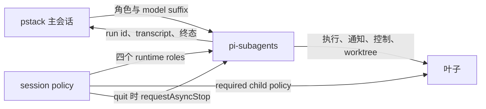

# 由 pi-subagents 统一持有 Pi 子任务执行

## 状态

Accepted for staged implementation. PR 1 只记录并验证准备工作的契约，不改变活动执行入口。

## 背景

Michael pstack 的 Pi extension 同时持有工作流策略和子进程执行。`AgentRunner` 负责角色、模型、记录和生命周期，`PiChild` 负责 `pi --mode rpc` 传输。历史 PR #156 和 #160 表明，这条路径解决的是当时的工作流缺口和 mailbox 复杂性，并非对执行所有权的永久要求。

pi-subagents 0.82.1 已提供角色注册、执行、通知、停止、续接和 worktree。继续维护两套执行协调会增加状态、退出和权限语义的分叉。迁移还必须保留 pstack 的 17 个模型角色、四个 prompt 角色、主会话 mandate、模型表、自动路由、ask 和 schedule。

## 决策

采用 runtime-only role publication 和单一 native execution owner。

- Pstack 保留 playbook、角色定义、模型和 thinking 分工。四个 prompt 角色不是 17 个模型角色的展开副本。
- PR 1 只加入 inert role projection、模型解析、策略 fixture 和 pending-activation 文档。不得注册静态 agent discovery，也不得改变生产 composition root。
- PR 2 在同一变更中发布 runtime roles、切换 mapping、删除旧工具注册和 RPC 专用模块。不得保留第二个活动入口、fallback 或兼容 runner。
- 模型和 effort 在父会话解析，通过 `provider/id:effort` 传给 native dispatch。`auto`、`inherit-parent` 和 `session` 不得落到无关的 native 默认值。
- Shared required child policy 只提供 guidance 和 delegation guard，不过滤 writer 工具。Role-local policy 负责 strict 或 writer 的最终工具边界。
- Native lifecycle artifacts 是执行事实来源。Pstack 只保留可重建的当前会话观察，不建立第二个 run 数据库、PID kill ladder 或完成通知器。

## 理由与取舍

Runtime registration 让角色身份、冲突回滚和 session policy 由一个边界持有。Static package discovery 被拒绝，因为若在 PR 1 发布，它会在策略激活前提供第二条可启动路径。

`contact_supervisor` 是明确允许的 native 控制通道例外。Strict review 角色不得获得 write、edit、bash、image generation 或 delegate 工具。工具声明、provider payload 和 tool-call guard 分别验收，frontmatter 不被当成完整最终工具表。

父退出默认保持旧取消语义。原生 `requestAsyncStop` 只表达停止意图，只有 native stopped/process-terminal 证据才能证明结束。SIGKILL 和未观察到的启动竞态不纳入保证。

历史记录和 worktree 保留为只读事实。旧 agent id 不转换为 native run id，切换时不得有存活的 legacy child。

## 备选方案

- Static package roles。减少注册代码，但会让 PR 1 提前暴露第二条启动面，并分裂静态与运行时策略。
- Pstack delegation facade。隐藏 native 参数形式，却复制路由和生命周期职责，形成第二个执行协调器。
- Coordinator child。把适配委托给另一个模型会话，增加权限、上下文和退出边界，不能解决宿主工具与进程控制问题。

## 验证

PR 1 要求公开 runtime discovery、17 角色解析、suffix precedence、严格工具 fixture、其他 runtime 不变，以及代表性真实 child transcript。PR 2 要求唯一 native 入口、无 Michael RPC spawn、完整生命周期、print/JSON settle、依赖与冲突 fail-closed、保留功能回归和独立审查。

当前隔离证据包括：

- `/tmp/pstack-subagents-contract.zBytCb/verify-runtime.mjs` 的 52 项检查。
- `/tmp/pstack-subagents-lifecycle/verify-lifecycle.mjs` 的 25 项检查，覆盖 strict、父退出、print 和 JSON。
- `/tmp/pstack-pr1-live/verification.json` 的 21 项检查，覆盖 runtime role discovery、真实 model/thinking、通知和叶子权限。

这些证据不代替 PR 1 的最终 commit 回归和 PR 2 的完整切换验收。

## 后果与回滚

PR 1 不改变活动行为，普通 revert 即可回滚，无需迁移 child 或安装。PR 2 的回滚必须恢复原 package source 和 commit，并保留 native transcript/worktree；不承诺把 native run id 转回 legacy agent id。

两张 PR 均不包含 merge、日常安装切换、模型或 herdr 配置修改、性能比较和其他 runtime 行为改造。
